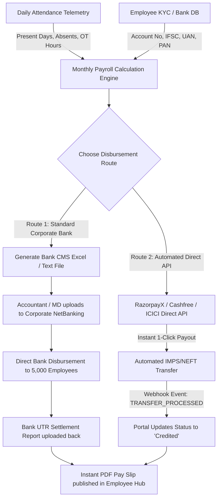

# 🏛️ SN ENVIRO FINANCIAL & PAYROLL HUB — MASTER ARCHITECTURE PLAN
**Document Version:** 1.0.0  
**Target Module:** Salary Hub, Bank Integrations, PF/ESI Breakdown & Automation  
**Target Audience:** Engineering, HR, MD & Accounts Department  
**Location:** `frontend/src/future_scope/PAYROLL_SALARY_HUB_MASTER_PLAN.md`

---

## 1. Executive Summary & Vision

The **Salary Hub** connects daily attendance telemetry to company financial disbursements. By capturing daily check-ins, check-outs, shift durations, overtime hours, and approved leaves, the SN Enviro Attendance Portal possesses the primary source-of-truth required to automate payroll.

This document outlines the master blueprint for transitioning from static salary records to a fully automated **Attendance-to-Bank Payroll Pipeline**, compliant with Indian statutory regulations (EPFO, ESIC, Income Tax, and Banking standards).

---

## 2. Statutory Data Points Required Per Employee

To generate legally compliant monthly pay slips and enable bank transfers, each employee record will store three categories of data:

### A. Banking Details (For Direct Credit)
| Field Name | Type | Description | Validation Rule |
| :--- | :--- | :--- | :--- |
| **Account Holder Name** | String | Exact name as registered in the bank | Must match Aadhaar/PAN |
| **Bank Name** | String | Name of bank (e.g., SBI, HDFC, ICICI) | Standard bank directory |
| **Account Number** | String | Bank Account Number | 9–18 digits (Encrypted at rest) |
| **Confirm Account Number** | String | Re-entered to prevent typos | Match Account Number |
| **IFSC Code** | String | 11-character Indian Financial System Code | `^[A-Z]{4}0[A-Z0-9]{6}$` |
| **Branch Name** | String | Bank branch location | Auto-fetched via Razorpay IFSC API |
| **Payment Mode** | Enum | Transfer method | `NEFT`, `RTGS`, `IMPS`, `UPI` |

### B. Statutory & Government Identification Numbers
| Field Name | Authority | Format / Length | Applicability |
| :--- | :--- | :--- | :--- |
| **UAN (Universal Account Number)** | EPFO | 12 Digits (Numeric) | Mandatory for employees earning Basic <= ₹15,000, recommended for all |
| **PF Member ID** | EPFO | Regional Office Code + Establishment ID + Extension + Member ID | Generated under company's EPFO establishment code |
| **ESIC Insurance Number** | ESIC | 17 Digits (Numeric) | Mandatory if Gross Salary <= ₹21,000/month |
| **PAN Card Number** | Income Tax Dept | 10 Alphanumeric (`[A-Z]{5}[0-9]{4}[A-Z]{1}`) | Mandatory for TDS deduction under Section 192 |
| **Aadhaar Number** | UIDAI | 12 Digits (Store only last 4 digits: `XXXX-XXXX-1234`) | KYC verification for UAN seeding |

---

## 3. Salary Breakdown & Calculation Engine

Indian payroll compliance divides salary into **Earnings**, **Statutory Deductions**, and **Employer Contributions**:

```
+-----------------------------------------------------------------------------------+
|                              MONTHLY CTC (Cost to Company)                        |
+-----------------------------------------------------------------------------------+
|  GROSS EARNINGS:                                                                  |
|    - Basic Pay (40% - 50% of CTC)                                                 |
|    - House Rent Allowance (HRA) (40% - 50% of Basic)                              |
|    - Special / Field Allowance                                                    |
|    - Conveyance / Fuel Allowance                                                  |
|    - Overtime Pay (Calculated from Portal Check-In/Check-Out Hours)               |
+-----------------------------------------------------------------------------------+
|  EMPLOYEE DEDUCTIONS:                                                             |
|    - Provident Fund (EPF): 12% of Basic (capped at ₹1,800/mo or actual)           |
|    - Employee State Insurance (ESIC): 0.75% of Gross (if Gross <= ₹21,000)        |
|    - Professional Tax (PT): State slab (e.g., ₹200/month in TS/AP/MH)             |
|    - Income Tax / TDS: Computed per employee's chosen regime (Old vs New)         |
|    - Loss of Pay (LOP): (Gross / Total Month Days) * Unapproved Absent Days       |
+-----------------------------------------------------------------------------------+
|  NET SALARY (TAKE HOME) = Gross Earnings - Total Deductions                       |
+-----------------------------------------------------------------------------------+
|  EMPLOYER CONTRIBUTIONS (Over and above Gross):                                   |
|    - Employer EPF: 3.67% (EPF) + 8.33% (EPS Pension) = 12% of Basic               |
|    - Employer ESIC: 3.25% of Gross Salary                                         |
+-----------------------------------------------------------------------------------+
```

---

## 4. "Connecting the Dots": How Portal Telemetry Links to Bank Accounts

There are two primary methods to bridge our attendance system with the banking infrastructure:

### Workflow Diagram



### Route 1: Corporate Bank CMS Bulk File Upload (Zero Third-Party Cost)
*Supported by: SBI Corporate, HDFC Enet, ICICI Corporate Internet Banking (CIB), Axis CMS.*
1. **At Month End (e.g., 1st of every month):**
   - The MD/Accountant visits `/admin/payroll` and clicks **"Generate Bank Disbursement Sheet"**.
   - The portal calculates payable days, overtime pay from attendance logs, deducts LOP, and produces an encrypted **Bank CMS Excel/CSV sheet**.
2. **Sheet Format Example:**
   ```csv
   BeneficiaryName,AccountNumber,IFSC,Amount,Remarks,Email
   Jaswanth,50100234567890,HDFC0000123,45000,Salary-Oct2026,jaswanth@snenviro.in
   Employee2,012345678901,SBIN0004567,38500,Salary-Oct2026,emp2@snenviro.in
   ```
3. **Execution:**
   - The Company Director/Accountant logs into Corporate NetBanking.
   - Uploads the sheet under **"Bulk Salary Upload"**.
   - Authenticates via Corporate Token / OTP.
   - The bank disburses all salaries within minutes.

### Route 2: Direct Banking API Integration (Fully Automated 1-Click Payouts)
*Supported by: RazorpayX Payouts, Cashfree Payouts, or Direct ICICI/HDFC Corporate APIs.*
1. The company maintains a Corporate Virtual Account with the payment partner.
2. In the MD Portal, the MD reviews the monthly payroll summary.
3. The MD clicks **"Approve & Disburse Payroll (₹XX,XX,XXX)"**.
4. The backend securely triggers the Banking Payout API:
   ```json
   POST /v1/payouts
   {
       "account_number": "50100234567890",
       "fund_account_id": "fa_12345",
       "amount": 4500000,
       "currency": "INR",
       "mode": "NEFT",
       "purpose": "salary",
       "reference_id": "SN-SAL-OCT26-EMP001"
   }
   ```
5. Bank processes payout instantly and fires a Webhook to our backend.
6. Our backend automatically updates the `Salary` record:
   - `status`: `"Credited"`
   - `creditedAt`: `Timestamp`
   - `transactionId`: `UTR / Bank Ref Number`
7. Employee receives an immediate push notification & email: *"Your salary for October 2026 of ₹45,000 has been credited (UTR: CMS123456789)"*.

---

## 5. UI/UX Workflow: Who Enters What?

### Step 1: Employee Self-Service / Onboarding (Employee Portal)
- Employee navigates to **Profile -> Bank & Statutory Info**.
- Fills:
  - Account Number & Re-type Account Number.
  - IFSC Code (Bank name and branch auto-fill via IFSC lookup).
  - UAN (EPFO) & ESIC Number (if existing, or checks *"First Job / Need new UAN"*).
  - PAN Number.
  - Uploads a photo of **Cancelled Cheque / Passbook First Page** (ensures zero account number mistakes).
- Status changes to: **"Pending HR Verification"**.

### Step 2: HR / Admin Approval (MD Portal)
- HR verifies the entered details against the uploaded cheque.
- Approves the KYC. Once approved, fields are locked for security (can only be edited with Admin OTP).

### Step 3: Monthly Slip Generation (Automated)
- On the 30th/31st of each month, the system compiles the attendance summary.
- Generates salary records with full breakdown.
- Once credited, employees can view the interactive voucher and click **"Download PDF Pay Slip"**.

---

## 6. Official SN Enviro Pay Slip Layout (PDF Design)

```
========================================================================================
                          SN ENVIRO SOLUTIONS PRIVATE LIMITED
                     Plot No. 42, Industrial Area, Hyderabad, India
                              CIN: U29300TG2020PTC123456
                               PAYSLIP FOR OCTOBER 2026
========================================================================================
Employee Name  : Jaswanth                 Employee ID     : SNE-0042
Designation    : Senior Developer         Department      : IT & Automation
Date of Joining: 15-Aug-2023              Bank Name       : HDFC Bank
UAN Number     : 100912345678             Account Number  : ************7890
ESIC Number    : 52-00-123456-000-0001    IFSC Code       : HDFC0000123
PAN Number     : ABCDE1234F               Total Days / LOP: 31 Days / 0 Days LOP
----------------------------------------------------------------------------------------
EARNINGS (₹)                 AMOUNT        DEDUCTIONS (₹)                AMOUNT
----------------------------------------------------------------------------------------
Basic Pay                    25,000.00     Provident Fund (EPF)           3,000.00
House Rent Allowance (HRA)   12,500.00     ESIC Deduction                     0.00
Special Allowance             8,500.00     Professional Tax (PT)            200.00
Conveyance Allowance          2,000.00     Income Tax / TDS               1,500.00
Overtime Pay (14.5 Hours)     4,250.00     Loss of Pay (0 Days)               0.00
----------------------------------------------------------------------------------------
GROSS EARNINGS          ₹    52,250.00     TOTAL DEDUCTIONS         ₹     4,700.00
----------------------------------------------------------------------------------------
NET PAYABLE SALARY (Take Home):   ₹ 47,550.00
In Words: Rupees Forty-Seven Thousand Five Hundred and Fifty Only
Status: CREDITED  |  UTR/Transaction ID: CMS9876543210  |  Credit Date: 05-Nov-2026
========================================================================================
         *This is a computer-generated salary slip and requires no physical signature.*
```

---

## 7. Implementation Roadmap (Phases)

| Phase | Milestone | Deliverables |
| :---: | :--- | :--- |
| **Phase 1** | **KYC & Banking Schema** | - Add `bankDetails`, `statutoryDetails` (UAN, ESIC, PAN) to `User.js`.<br>- Build Bank & KYC Edit form in Employee Profile with Cancelled Cheque upload.<br>- Build HR Approval Panel in `/admin`. |
| **Phase 2** | **Attendance-to-Payroll Engine** | - Build monthly attendance aggregation query (Present days, Paid Leaves, LOP, Overtime hours).<br>- Dynamic calculation engine applying Indian statutory formulas (EPF, ESI, PT). |
| **Phase 3** | **PDF Payslip & Archive** | - Dynamic PDF generation using `pdfmake` or `html2pdf.js`.<br>- Employee 1-click download with official SN Enviro letterhead and styling. |
| **Phase 4** | **Bank Integration (CMS & API)** | - Step 1: Export Bank Bulk Payment Sheet (HDFC/SBI/ICICI CSV format).<br>- Step 2: Integrate RazorpayX / Corporate Banking Payout API for 1-click automatic bank disbursements. |

---

## 8. Security & Compliance Safeguards

1. **Bank Account Encryption:** Account numbers and PAN are encrypted at rest using AES-256 before saving to MongoDB.
2. **Access Control:** Only the employee and authorized Finance/MD users can view bank account numbers. Masked format (`**** **** 7890`) is displayed on frontend screens.
3. **Audit Trail:** Any change to an employee's bank details generates an immutable log with Admin approval and notification email to the employee.
4. **Statutory Archive:** Pay slips must be preserved for 7 years in accordance with Indian Companies Act & Tax Laws.
